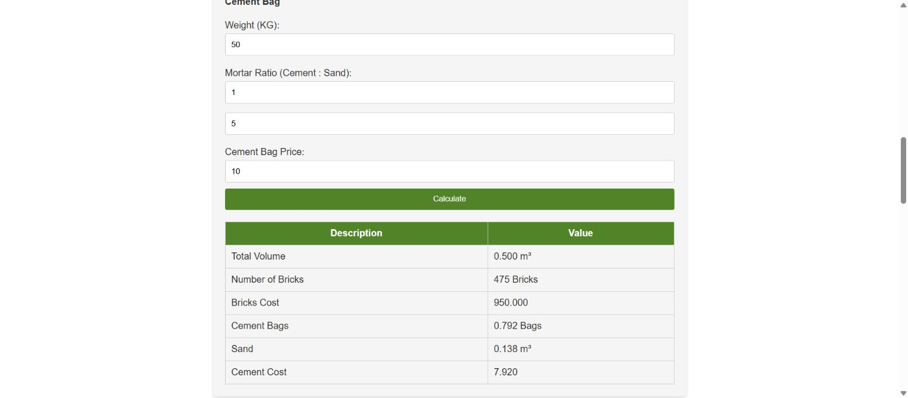

# Brick Wall Calculator – Bricks, Cement & Sand

A browser-based estimate of bricks, cement bags, sand, and selected costs, developed by [Ozairwebs](https://ozairwebs.com/). Supports wall dimensions in feet or meters, brick dimensions in inches or millimeters, and deductions for openings.

**[Open the calculator](https://ozairweb.github.io/brick-wall-calculator/)** · [Source files](index.html)

## Features

Feet or meters; custom brick sizes; opening deductions; bag weight; mortar ratio; whole brick count; cement and sand estimates; selected costs; validation and responsive layout.

## Example screenshot

## Run it

Download the repository and open `index.html`. No package installation, build step, or backend is required. The existing [360civil Engineering demo](https://360civil-engineering.com/brick-calculator/) is separately published and may not include the latest repository changes.

## Calculation and assumptions

- Net wall volume = `(length × height − opening area) × thickness`.
- Brick volume = `brick length × width × thickness`.
- Brick count = `ceil(net wall volume / brick volume × 0.94921875)`.
- Dry mortar allowance = `net wall volume × 0.33`.
- Cement and sand volumes follow the entered cement: sand ratio.
- Cement bags = `cement volume in m³ × 1440 / bag weight in kg`.
- Brick cost = `whole brick count × price per brick`; cement cost = `estimated bags × price per bag`.

The brick adjustment and mortar allowance are legacy assumptions retained from the original project, not a model of actual mortar joints. Cement density is assumed at **1,440 kg/m³**. Both unit paths now use the same mortar allowance and density; the earlier version applied different factors. Brick rounding happens after adjustment, so output is a whole count.

## Worked example

For a wall **3 m long, 2 m high and 100 mm thick**, with **1 m²** of openings, net volume is **0.5 m³**. Using bricks **200 × 100 × 50 mm**, the tool estimates **475 bricks**. A **1:5** mortar ratio and **50 kg** bag weight give **0.792 cement bags** and **0.1375 m³ sand**. Brick price **2** and cement bag price **10** produce costs of **950** and **7.92**, in the currency of your entered prices.

Exact equivalent imperial dimensions give the same calculation, except for display rounding. Default brick dimensions in the two modes are separately rounded presets; use exact converted dimensions for an equivalence comparison.

## Validation and use

Dimensions, ratio parts, and bag weight must be positive finite numbers. Opening area and prices must be non-negative, and openings must be smaller than the wall area. Invalid inputs hide the previous result. Switching unit mode also hides results. Prices do not perform currency conversion or use live market rates.

## Practical verdict

Suitable for an early estimate and to demonstrate a Custom web tool. Confirm brick sizes, joint thickness, bond, mortar specification, waste, and purchase rounding for the project. It does not check structural requirements or include labor, transport, sand cost, taxes, or automatic waste allowance.

## Maintain and extend

The form lives in `index.html`, calculations in `script.js`, and responsive styles in `style.css`. After formula changes, recheck the worked example, equivalent units, zero dimensions, oversized openings, and negative prices. Replace the documented legacy adjustment with a configurable joint model rather than silently adding another factor.

Use issues for reproducible defects with entered values and browser details. For Custom tools, dashboards, or website development, [discuss your requirements with Ozairwebs](https://ozairwebs.com/company/contact/).

